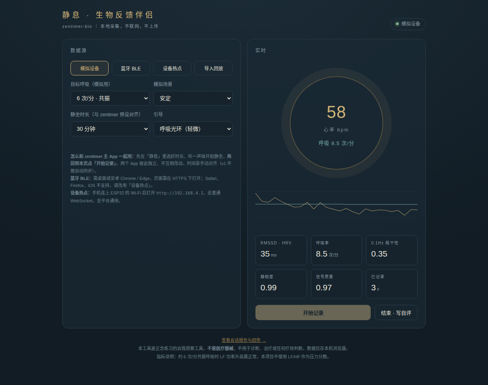

# zentimer-bio

> 给 [zentimer（静息）](https://github.com/yaohui-git/zentimer) 做的**开源、低成本**冥想生理反馈硬件与伴侣页。
> 监控 → 分析 → 指导，全部本地，不联网，不上传。

**本工具是正念练习的自我观察工具，不是医疗器械**，不用于诊断、治疗或任何疗效判断。指标趋势仅供参考。

---

## 它和 zentimer 是什么关系

`zentimer` 是一款完全离线、极简禅意的 Android 静坐计时器（Kotlin + Compose，只申请一项通知权限，无 `INTERNET` 权限，明确没有练习记录与统计）。

**本项目不改动它，一个字都不改。** 独立提供硬件 + 一个伴侣页：

```
zentimer（主 App）          zentimer-bio（本仓库）
  · 计时 / 钵声 / 留白        · 指夹采集 HRV、呼吸、体动
  · 保持原样                  · 实时波形 / 会话报告 / 纵向趋势
                             · 主观自评 / 共振呼吸引导
        └── 手动时间对齐 ──────────┘
```

为什么这样设计，以及 v0.1 方案错在哪里，见 [`docs/adr-001-architecture.md`](docs/adr-001-architecture.md)。



## 5 分钟上手（零硬件）

1. 打开 [`web/index.html`](web/index.html)（直接双击，或挂到任意静态服务器；无需构建、无需安装）。
2. 数据源保持「模拟设备」，选目标呼吸 `6 次/分 · 共振`，时长选 `2 分钟 · 试用`。
3. 点「开始记录」→ 看实时心率曲线、RMSSD、呼吸率、相干性、呼吸光环。
4. 结束后填 10 秒主观自评 → 保存 → 打开 [`web/report.html`](web/report.html) 看报告与趋势。

命令行生成一份可分析的示例会话：

```bash
python3 tools/synth_ppg.py --minutes 10 --br 6.0 --out data/sample_sessions/demo.json --csv demo.csv
python3 tools/analyze.py data/sample_sessions/demo.json
```

需要真实数据？把一条支持 RR 间期的标准 BLE 心率带（CooSpo H808S / Polar H9）连上 Chrome，数据源选「蓝牙 BLE」即可，无需自研硬件。

## 硬件：从 ¥50 开始

| 阶段 | 成本 | 内容 |
|---|---|---|
| S0 零硬件 | ¥0 | 合成数据 + 模拟设备；可选标准 BLE 心率带做真实 HRV |
| **S1 指夹原型** | **¥50–100** | ESP32-C3 + MAX30102，面包板 4 根线，**零焊接、零 PCB、零电池**，USB 供电，网页一键烧录 |
| S2 完整原型 | ¥200–350 | 加皮电、体动、电池、3D 打印外壳、可选 PCB |
| S3 扩展 | 按需 | 优先做「兼容第三方设备」，不自研 EEG |

采购清单见 [`hardware/bom.csv`](hardware/bom.csv)，照着插线见 [`hardware/wiring.md`](hardware/wiring.md)。

## 两条数据通道

| 通道 | 怎么用 | 适用 |
|---|---|---|
| **ESP32 AP 热点 + WebSocket（主）** | 手机连 `zentimer-bio-XXXX` 热点，浏览器打开 `http://192.168.4.1` | 完全离线、自托管、所有浏览器通用、无需 HTTPS/外网 |
| Web Bluetooth（辅） | 桌面/安卓 Chrome 打开 HTTPS 伴侣页，点「蓝牙 BLE」 | 桌面调试、接第三方标准心率带 |

协议见 [`protocol/gatt.md`](protocol/gatt.md)、[`protocol/ws.md`](protocol/ws.md)、[`protocol/schema.json`](protocol/schema.json)。

## 目录

```
README.md  ROADMAP.md  CONTRIBUTING.md
docs/       adr-001-architecture.md / disclaimer.md / privacy.md /
            assemble.md / calibration.md / experiment-protocol.md
web/        zenbio.js（4 个数据源适配器 + 指标计算 + 会话存储）
            index.html（伴侣页）  report.html（报告与趋势）  flash.html（网页烧录，阶段 1）
tools/      synth_ppg.py（合成数据）  analyze.py（HRV / 呼吸 / 相干性离线分析）
hardware/   bom.csv  wiring.md  kicad/（S2）  enclosure/（S2，OpenSCAD）
protocol/   gatt.md  ws.md  schema.json
firmware/   PlatformIO 工程（S1，见 ROADMAP 排期）
data/       sample_sessions/  annotation_template.csv
LICENSES/   许可证矩阵
```

## 关键设计原则

- **不打扰**：默认静默采集，只在会话首尾提示；引导是极轻微的光环，不弹窗、不出声。
- **主观标注必填**：没有自评，生理数据只是数字，不构成「效果」。
- **不误读指标**：约 6 次/分共振呼吸时 LF 功率升高属正常，**不使用 LF/HF 作为压力分数**；主指标是 RMSSD、0.1 Hz 相干性、静稳度。
- **数据全本地**：无账号、无云、无埋点、无订阅，导出由用户主动触发。
- **可复现**：BOM 给替代料与搜索词，接线表照着插，验收标准是「外人照文档能独立复现」。

完整路径、资源清单与我/你/第三方的分工、14 周排期、风险与合规清单，见 [`ROADMAP.md`](ROADMAP.md)。

## 许可证

| 资产 | 协议 |
|---|---|
| 代码（固件 / 网页 / 脚本） | Apache-2.0（与 zentimer 主仓库一致） |
| 硬件设计 | CERN-OHL-S-2.0 |
| 文档 | CC-BY-4.0 |
| 示例数据 | CC0-1.0 |

详见 [`LICENSES/README.md`](LICENSES/README.md)。**本仓库不复用 zentimer 主仓库的任何音频/图片素材**（那些是第三方资产，不在其 Apache-2.0 范围内）。
